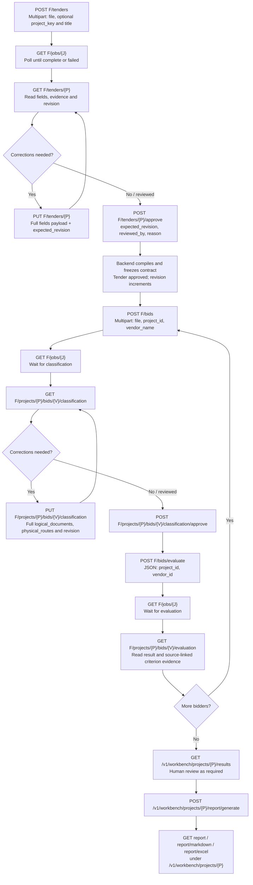
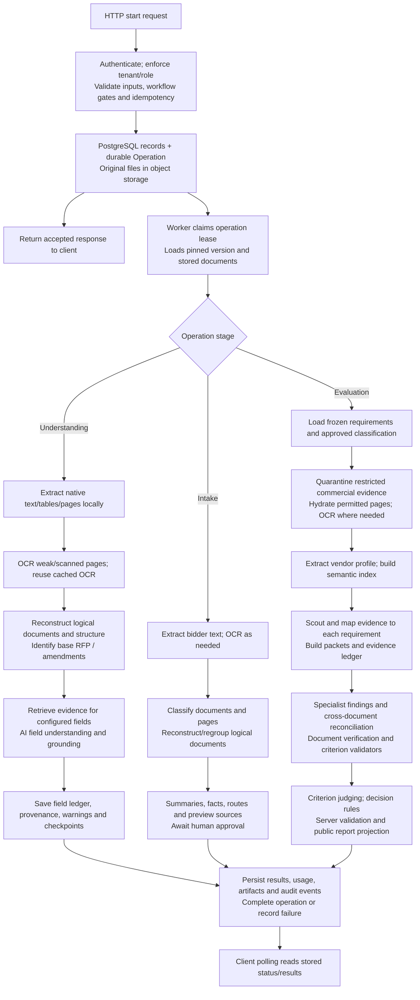
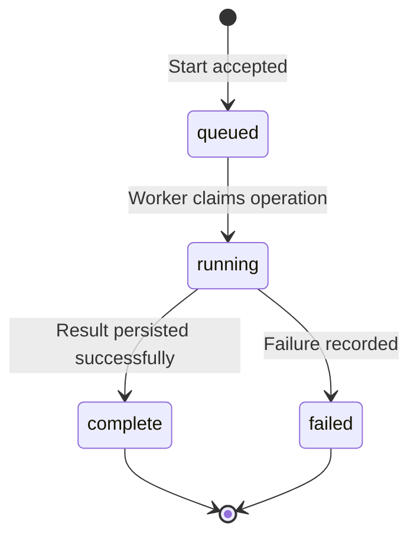

# Complete procurement workflow with APIs

Source-traced against this repository on 2026-10-01. This describes implemented behavior, not a live network capture. Provider hosts and enabled capabilities depend on deployment configuration.

## 1. Which API journey applies?

| Client | API surface | How it starts work |
|---|---|---|
| Existing browser workbench | `/v1/workbench` plus `/workbench/account` | Upload and processing are separate calls. |
| General external integration | `/v1/pipeline` plus workbench review routes | Each start call combines resource creation/upload and queueing. Supports a supplied field schema. |
| Fixed-schema external integration | `/v1/pipeline/fixed-schema` plus workbench results/report routes | Fixed tender fields, full review PUTs, revision checks, separate result GETs. |

These are alternative entry points into the same durable processing system. A client does not need to execute all three journeys. The browser's `apiUrl()` expands shorthand `/workbench/projects/...` calls into actual `/v1/workbench/projects/...` requests.

Notation below: `P = project_id`, `V = vendor_id` (called `vendor_key` in some route definitions), `J = job_id`. Replace placeholders with returned values. Local base URL: `http://127.0.0.1:8000`.

## 2. Existing browser: complete workflow diagram

All project routes inside this diagram have prefix `/v1/workbench/projects/{P}` unless a full path is shown. Dashed branches are conditional.

```mermaid
flowchart TD
    A["Open /workbench/login"] --> B["POST /workbench/account/login<br/>Authenticate and establish browser session"]
    B --> C["GET /workbench/account<br/>GET /v1/workbench/projects<br/>Load account and existing projects"]
    C --> D["GET /v1/workbench/field-schema/default<br/>POST /v1/workbench/projects<br/>Upload tender and create project"]
    D --> E["POST /understand<br/>Queue tender understanding"]
    E --> F["GET /v1/workbench/jobs/{J}<br/>Poll worker operation"]
    F --> G{Completed successfully?}
    G -->|Running| F
    G -->|Failed| X["Show error; retain IDs<br/>Resolve cause before retry"]
    G -->|Yes| H["GET /ledger and /documents<br/>Review extracted tender fields and sources"]
    H -.-> I["POST /ledger/corrections<br/>Correct fields with reason and reviewer"]
    I --> H
    H -.-> K["POST /compliance/run<br/>Poll job; GET /compliance"]
    K -.-> L["POST /compliance/policy<br/>POST /compliance/findings/{finding_id}/resolve<br/>Resolve applicable policy findings"]
    L --> M
    H --> M["POST /contract/draft<br/>GET /contract/draft<br/>Build and review evaluation checklist"]
    M -.-> N["PATCH /contract/draft<br/>Save checklist edits"]
    N --> M
    M --> O["POST /contract/freeze<br/>Approve tender and freeze criteria"]
    O --> Q{Freeze accepted?}
    Q -->|409; unresolved requirements| M
    Q -->|Yes| R["POST /bids<br/>Upload bidder package; repeat per bidder"]
    R --> S["POST /intake<br/>Queue bidder classification"]
    S --> T["GET /v1/workbench/jobs/{J}<br/>Wait for intake completion"]
    T --> U["GET /bids/{V}/classification<br/>GET /bids/{V}/review<br/>Inspect document types, pages and evidence"]
    U -.-> W["POST /bids/{V}/classification/correct<br/>Correct boundaries and document routes"]
    W --> U
    U --> Y["POST /bids/{V}/classification/approve<br/>Approve classification for each bidder"]
    Y --> Z["POST /evaluate<br/>Queue approved bidder evaluations"]
    Z --> AA["Poll returned jobs<br/>GET /results<br/>Read criterion decisions and evidence"]
    AA -.-> AB["POST /vendors/{V}/criteria/{criterion_id}/human-review<br/>Record reasoned human decision"]
    AB --> AA
    AA -.-> AC["Clarification lifecycle if enabled<br/>Create, issue, record response, close"]
    AC --> AA
    AA --> AD{All bidder reports available?}
    AD -->|No| AA
    AD -->|Yes| AE["POST /report/generate<br/>Set report_generated and assemble reports"]
    AE --> AF["GET /report<br/>GET /report/markdown<br/>GET /report/excel"]
    AF --> AG["End: committee reviews results and recommendation<br/>No automatic procurement award is implied"]
```



Job failure handling also applies to intake, compliance, and evaluation, not only understanding. A completed job means processing finished; it does not mean human approval or that the bidder passed.

## 3. What happens at every browser step

Here `W` means `/v1/workbench/projects/{P}`.

| Step | API hit | What the server does / what the client receives |
|---|---|---|
| 1. Login | `POST /workbench/account/login` | Validates configured account credentials and establishes the browser session. API integrations instead use deployment-configured token/JWT authentication. |
| 2. Resume or create | `GET /workbench/account`, `GET /v1/workbench/projects`, `GET W` | Loads account/project state so the UI can resume the current stage. |
| 3. Schema and upload | `GET /v1/workbench/field-schema/default`; `POST /v1/workbench/projects` | Validates tender upload, creates project/tender/version records, stores original documents, associates the field schema. Returns project state/identifiers. |
| 4. Start understanding | `POST W/understand` | Creates a durable understanding operation. Returns HTTP 202 and job information. Extraction runs in the worker. |
| 5. Poll | `GET /v1/workbench/jobs/{J}` | Reads operation state/progress. The browser also has an operation-status read through `GET /v1/operations/{operation_id}`. Polling does not start AI work. |
| 6. Review tender | `GET W/ledger`, `GET W/documents`, source preview GETs | Returns extracted values, missing/unresolved fields, conditions, exceptions, required bidder documents, and source evidence. |
| 7. Correct tender | `POST W/ledger/corrections` | Records a reviewed field value, status, reason and reviewer metadata. Approved/frozen state cannot be casually overwritten. |
| 8. Compliance, where used | `POST W/compliance/run`; poll; `GET W/compliance` | Runs the tender policy audit as a separate operation. `POST W/compliance/policy` changes the selected policy; `POST W/compliance/findings/{finding_id}/resolve` records resolution. |
| 9. Build checklist | `POST W/contract/draft`, `GET W/contract/draft` | Compiles tender findings into evaluable criteria with evidence requirements and source references. GET reads the existing representation. |
| 10. Edit checklist | `PATCH W/contract/draft` | Persists reviewed checklist changes before freezing. |
| 11. Freeze | `POST W/contract/freeze` | Checks the reviewed criteria, saves a frozen contract, approves the tender version and moves the project to `contract_frozen`. Unresolved criteria can block the transition. An explicitly permitted limitations path records exclusions; it does not silently treat them as passed. |
| 12. Add bidders | `POST W/bids` | Stores a bidder package and bidder identity. Repeat for each bidder. Use the returned vendor key. |
| 13. Classify | `POST W/intake`; poll returned job | Worker extracts bidder pages, classifies documents/pages, reconstructs logical documents, summarizes them and proposes physical routes. |
| 14. Review classification | `GET W/bids/{V}/classification`, `GET W/bids/{V}/review` | Returns AI-proposed document groupings, page ranges, routes and previews. |
| 15. Correct / approve | `POST W/bids/{V}/classification/correct`; `POST W/bids/{V}/classification/approve` | Saves reviewed document groupings and approves the classification. Correction and approval are separate actions. |
| 16. Evaluate | `POST W/evaluate` | Requires an approved tender with frozen criteria and approved selected bidder classifications. Optional JSON `vendor_id` selects one bidder. Queues work and returns job/state information. |
| 17. Results | Poll returned jobs; `GET W/results` | Returns per-bidder decisions, criterion results, missing evidence, review needs and financial-opening information. |
| 18. Human decision | `POST W/vendors/{V}/criteria/{criterion_id}/human-review`; `GET W/review-log` | Adds a review record tied to a completed evaluation and known criterion. Keeps an audit trail and refreshes the award recommendation. |
| 19. Report generation | `POST W/report/generate` | Checks whether every bidder has a report. When complete, sets project stage `report_generated`, records an audit event and refreshes the recommendation. Returns `complete`, `missing_vendors`, reports and recommendation. |
| 20. Read/export | `GET W/report`, `GET W/report/markdown`, `GET W/report/excel` | Returns JSON or downloadable Markdown/Excel. Reading/exporting is not the explicit `report_generated` transition. JSON can return HTTP 200 with `complete:false`. |

## 4. General external integration: exact call sequence

```mermaid
sequenceDiagram
    actor User as Officer / reviewer
    participant Client
    participant API as Procurement API
    participant DB as PostgreSQL / object storage
    participant Worker
    participant AI as Configured AI / OCR services
    Client->>API: POST /v1/pipeline/tenders/understand (multipart)
    API->>DB: Store tender, project, version, documents and operation
    API-->>Client: 202: job_id, job_url, project_id, tender/version IDs
    Worker->>DB: Claim durable operation and load documents
    Worker->>AI: Conditional OCR; field understanding calls
    Worker->>DB: Save understanding and complete operation
    loop Until complete or failed
        Client->>API: GET /v1/pipeline/jobs/{job_id}
        API-->>Client: status, error or result
    end
    User->>Client: Review tender evidence and correct findings
    Client->>API: GET /v1/workbench/projects/{P}/ledger
    opt Corrections needed
        Client->>API: POST /v1/workbench/projects/{P}/ledger/corrections
    end
    Client->>API: POST /v1/workbench/projects/{P}/contract/draft
    Client->>API: GET /v1/workbench/projects/{P}/contract/draft
    User->>Client: Approve reviewed checklist
    Client->>API: POST /v1/workbench/projects/{P}/contract/freeze
    loop Each bidder
        Client->>API: POST /v1/pipeline/bids/classify (file, project_id, vendor_name)
        API-->>Client: 202: job_id, bid_id, vendor_id
        Worker->>AI: OCR if needed; document/page classification
        Worker->>DB: Save intake and classification
        Client->>API: GET /v1/pipeline/jobs/{job_id} until terminal
        User->>Client: Review and correct classification
        Client->>API: POST /v1/workbench/projects/{P}/bids/{V}/classification/approve
        Client->>API: POST /v1/pipeline/bids/evaluate (project_id, vendor_id)
        API-->>Client: 202: job_id, evaluation_id
        Worker->>DB: Load frozen checklist and approved bidder evidence
        Worker->>AI: Evidence retrieval / verification / judging as needed
        Worker->>DB: Save validated evaluation and audit artifacts
        Client->>API: GET /v1/pipeline/jobs/{job_id} until terminal
        API-->>Client: result.evaluation
    end
    Client->>API: GET /v1/workbench/projects/{P}/results
    User->>Client: Review findings and record decisions where needed
    Client->>API: POST /v1/workbench/projects/{P}/report/generate
    Client->>API: GET /v1/workbench/projects/{P}/report/excel
    API-->>Client: Report download
```

Main request inputs:

| Start route | Body | Returned identifiers |
|---|---|---|
| `POST /v1/pipeline/tenders/understand` | Multipart `file`; optional `schema_json`, `project_key`, `title` | `job_id`, `project_id`, `tender_id`, `tender_version_id` |
| `POST /v1/pipeline/bids/classify` | Multipart `file`, `project_id`, `vendor_name` | `job_id`, `project_id`, `bid_id`, `vendor_id` |
| `POST /v1/pipeline/bids/evaluate` | JSON `{"project_id":"...","vendor_id":"..."}` | `job_id`, `project_id`, `bid_id`, `vendor_id`, `evaluation_id` |

Send authentication and a stable `Idempotency-Key` for each logical start operation. Use the same key for a retry of the same inputs. Store every returned identifier and follow returned links. A repeated request may return an existing completed operation rather than recomputing.

## 5. Fixed-schema integration: complete diagram

In this diagram `F = /v1/pipeline/fixed-schema`. All writes shown under `F` require `Idempotency-Key`.



Important fixed-schema behavior:

- `GET F/jobs/{J}` returns status metadata, **not the full stage result**. Fetch the dedicated tender, classification or evaluation GET after completion.
- Tender review PUT uses `schema_version: procurement-fixed-tender-review.v1`, `schema_id: tender-agent-reviewed-condensed-v2`, `expected_revision`, `reviewed_by`, `reason`, and the complete `fields` mapping.
- Classification review PUT uses `schema_version: procurement-fixed-classification-review.v1`, `expected_revision`, `reviewed_by`, `reason`, `logical_documents`, and `physical_routes`.
- Approval bodies use `expected_revision`, `reviewed_by`, `reason`; tender approval also supports `continue_with_limitations`.
- Reload the latest resource after every successful write. A stale revision returns `409 REVISION_CONFLICT`; approved resources reject overwrites with `RESOURCE_FROZEN`.
- Fixed tender approval internally creates/freezes the draft. The separate general-workbench draft/freeze sequence is not an additional required step for this journey.
- Classification approval rejects a detected tender mismatch or unresolved `needs_review` documents. AI job completion alone never approves classification.

## 6. Worker internals: what happens after an API start

These are Python processing stages, **not separate frontend HTTP endpoints**.



The worker is a separate process (`procurement-worker`). PostgreSQL holds durable operation state; requests do not need to remain open while processing. Leases/checkpoints protect ownership and support recovery. An in-progress job must be polled, not repeatedly submitted as new work.

Evaluation uses the approved checklist rather than creating a new unreviewed tender policy. It builds evidence per criterion, checks required proof and applies server-side decision validation. Missing/failed mandatory requirements and unresolved material evidence affect qualification and financial-opening controls. Technical qualification, financial-opening permission and a committee award decision are separate concepts.

## 7. Which external APIs can the worker hit?

These calls originate from the backend/worker, not from browser JavaScript. Exact hosts/models are configuration-dependent; this document does not assert which deployment is currently active.

| Capability | API/transport implemented | When it is used |
|---|---|---|
| Native Gemini generation | `POST {GEMINI_BASE_URL}/models/{model}:generateContent` | Native Gemini semantic/model calls when selected. Default base in code is `https://generativelanguage.googleapis.com/v1beta`. |
| OpenAI-compatible primary LLM | SDK `chat.completions.create`, normally `POST {AI_PRIMARY_BASE_URL}/chat/completions` | Field understanding, classification, summaries and other semantic stages routed through the compatible provider. Capability URL can inherit `AI_BASE_URL`. |
| AI OCR | Compatible OCR capability via `AI_OCR_BASE_URL` and configured OCR model | Image/page extraction when the AI OCR provider is selected. |
| Hosted Paddle OCR | `PaddleOCRClient.parse_document` using `PADDLEOCR_BASE_URL` | Selected weak/scanned PDF pages. SDK manages upload/processing/polling; exact SDK HTTP subpaths are not specified by this repository. |
| Local Paddle OCR | Local library/runtime; no hosted HTTP request | Only when local Paddle is selected and installed. |
| Embeddings | SDK `embeddings.create`, normally `POST {AI_EMBEDDING_BASE_URL}/embeddings` | Semantic retrieval/indexing when enabled and needed. |
| Reranking | Default chat-style call at `AI_RERANKER_BASE_URL`; `POST {AI_RERANKER_BASE_URL}/rerank` when `AI_RERANKER_API_STYLE=rerank` | Reorders retrieved evidence candidates. |
| Verifier | Compatible chat capability at `AI_VERIFIER_BASE_URL` with verifier model | Evidence/verification calls assigned to the verifier capability. |
| Object storage | Configured S3-compatible client operations | Store original uploads/preview artifacts and retrieve them for workers/source delivery. |
| PostgreSQL | Database connection, not a public HTTP API | Projects, versions, bids, jobs, evaluations, approvals and audit persistence. |

Native parsing, deterministic rules and cache hits need no new model call. Conditional features and retries mean there is no fixed number of provider requests per uploaded file. Provider fallback is disabled; a failed provider is not silently replaced by a different model.

## 8. Evidence, review, clarification and revision branches

| Purpose | Actual API routes |
|---|---|
| Tender original/preview source | `GET /v1/workbench/projects/{P}/sources/{source_id}/content`; `GET /v1/workbench/projects/{P}/sources/{source_id}/pages/{page_number}.png` |
| Bidder original/preview source | `GET /v1/workbench/projects/{P}/bids/{V}/sources/{source_id}/content`; corresponding `/pages/{page_number}.png` |
| Stored document | `GET /v1/workbench/documents/{document_id}/content`; corresponding `/pages/{page_number}.png` |
| Create/list clarification | `POST` / `GET /v1/workbench/projects/{P}/clarifications` |
| Clarification lifecycle | `POST /v1/workbench/clarifications/{clarification_id}/issue`, `/response`, `/close` |
| Tender replacement/history | `POST /v1/workbench/projects/{P}/tender/reupload`; `GET .../tender/revisions` |
| Bidder replacement/history | `POST /v1/workbench/projects/{P}/bids/{V}/replace`; `GET .../revisions` |
| Propose classification again | `POST /v1/workbench/projects/{P}/bids/{V}/classification/propose` |
| BHEL individual result | `GET /v1/pipeline/fixed-schema/projects/{P}/bids/{V}/evaluation/bhel` |
| BHEL comparison | `GET /v1/workbench/projects/{P}/results/bhel` |
| Audit verification | `GET /v1/workbench/audit/verify` |

Follow returned source URLs and send authentication. Page numbers are 1-based. A preview GET returns file/image bytes, not a JSON evaluation.

Clarification routes record workflow state; their names alone do not imply an external email was sent. With the BHEL frozen-submission profile, later submission mutations/clarifications are restricted (`BHEL_SUBMISSION_FROZEN`, `BHEL_CLARIFICATIONS_DISABLED`). BHEL human review preserves the original `ai_result` while exposing the effective reviewed decision.

Replacement is a version/review branch, not permission to overwrite frozen findings in place. Re-read current project state and complete the required downstream stages after replacement.

## 9. Status, errors and completion rules



The diagram uses the public pipeline status vocabulary. Internal operation/evaluation records can use `succeeded`; do not assume every API family returns identical envelopes.

| Condition | Client behavior |
|---|---|
| HTTP 202 | Save IDs, then poll. It is acceptance, not completion. |
| `queued` / `running` | Continue polling the returned job URL, typically every 2–5 seconds. |
| `complete` | General pipeline: consume `result`. Fixed schema: perform the result GET. Check review requirements separately. |
| `failed` | Stop polling, show returned error/code and retain IDs. Diagnose before starting replacement work. |
| 400 / 422 | Correct the submitted data. |
| 401 / 403 | Restore authentication or use an authorized role. |
| 404 | Check tenant and returned identifiers. |
| 409 | Resolve workflow, revision, duplicate, frozen-resource or idempotency conflict. |
| 413 / 415 | Correct upload size or file/media format. |
| 429 / temporary 503 / network timeout | Back off; respect `Retry-After` where supplied. Retry the same logical start with its original idempotency key. |
| Report `complete:false` | Show `missing_vendors`; generation has not completed the project. |

There is no public v1 job-cancellation route. Aborting browser polling does not cancel worker execution. A browser timeout is not proof that the backend operation failed.

`GET /health` is liveness; `GET /ready` checks readiness dependencies. Run API and worker processes for the full journey. Legacy `/evaluate` and `/jobs/{id}` compatibility routes are disabled in production and are not the production workflow described here.

## 10. Source map

| Area | Repository source |
|---|---|
| Browser route expansion / actual calls | `frontend/modules/runtime.js`, `tender-setup.js`, `tender-review.js`, `checklist-actions.js`, `bid-intake.js`, `bid-classification-actions.js`, `results-actions.js`, `report.js` |
| General pipeline | `procurement/pipeline_api.py` |
| Fixed-schema routes, revisions and approvals | `procurement/fixed_pipeline_api.py` |
| Tender review / freeze | `procurement/workbench/projects.py` |
| Bidder upload / classification / approval | `procurement/workbench/bidders.py` |
| Compliance | `procurement/workbench/compliance.py` |
| Evaluation / review / report routes | `procurement/workbench/evaluation_runs.py`, `evaluation_results.py`, `evaluation_reports.py` |
| Durable execution | `procurement/worker.py`, `procurement/jobs/dispatcher.py`, `procurement/jobs/stages.py`, `procurement/platform/operations.py` |
| Processing internals | `procurement/pipelines/tender_understanding.py`, `bidder_intake.py`, `bid_evaluation.py` |
| Outbound provider calls | `procurement/platform/llm.py`, `procurement/providers/settings.py`, `transport.py`, `json_protocol.py`, `embeddings.py`, `reranking.py`, `procurement/understanding/ocr_providers.py` |
| Existing request/response examples | `docs/PIPELINE_API.md`, `docs/api-consumer/README.md`, `docs/api-consumer/openapi.json` |

Validation scope: route names, frontend path rewriting, approval behavior, worker sequence and provider transports were checked against local source. No live uploads, model calls or production workflow mutations were executed to produce this document.
