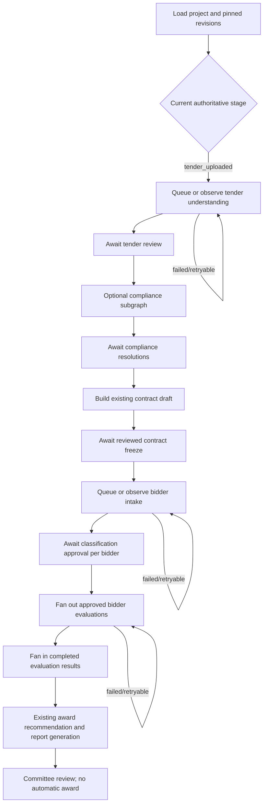

# LangGraph Multi-Agent Implementation Plan

Status: implementation blueprint only; no procurement business logic is changed by this plan.

Prepared against this repository on 2026-10-12.

## 1. Executive decision

Use LangGraph as a deterministic orchestration layer around the existing procurement pipeline. Do not introduce a free-form LLM supervisor. Do not let an agent select procurement rules, change approval state, infer workflow transitions, or produce a final award by itself.

The existing code remains authoritative for:

- PostgreSQL operations, leasing, retries, idempotency, audit chaining, and recovery.
- Tender extraction, OCR, field understanding, compliance, bidder classification, evidence retrieval, validation, evaluation, and reporting.
- Human correction, classification approval, contract freeze, finding resolution, clarification, and final committee review.
- Pydantic contracts, fixed-schema API responses, evidence grounding, and deterministic decision rules.
- Provider selection, India-region assertions, retry policy, timeouts, usage accounting, and the rule that provider fallback is disabled.

LangGraph will add:

- An explicit, inspectable workflow graph.
- Typed state containing identifiers and control metadata, not full documents.
- Safe fan-out/fan-in for independent bidder and criterion work.
- Pause/resume representation for the human gates that already exist.
- Node-level tracing, latency, cost, and failure attribution.
- A controlled migration path protected by feature flags and parity tests.

This is the most cost-efficient design because graph routing is code, not an extra LLM call. Existing model calls are reused rather than duplicated.

## 2. Why this pattern fits this repository

LangGraph is intended for custom workflows that mix deterministic code with agentic steps. That is a better fit than a conversational supervisor because this application already has strict stages and regulated decision gates.

The current durable flow is implemented in:

- `procurement/jobs/dispatcher.py`: operation claim, stage dispatch, retry, failure, and recovery.
- `procurement/jobs/stages.py`: understanding, compliance, intake, and evaluation operation boundaries.
- `procurement/pipelines/tender_understanding.py`: tender extraction and field understanding.
- `procurement/pipelines/bidder_intake.py`: bidder extraction and classification.
- `procurement/pipelines/bid_evaluation.py`: evidence, verification, criterion judging, and report production.
- `procurement/platform/operations.py`: durable operations and immutable audit events.
- `procurement/providers/*` and `ai_provider.py`: model capabilities, retries, caching, limits, and usage.

The graph must call these boundaries. It must not reimplement them.

Official references used for the design:

- LangGraph overview: https://docs.langchain.com/oss/python/langgraph/overview
- LangGraph persistence: https://docs.langchain.com/oss/python/langgraph/persistence
- LangGraph interrupts: https://docs.langchain.com/oss/python/langgraph/interrupts
- LangChain multi-agent patterns: https://docs.langchain.com/oss/python/langchain/multi-agent
- LangChain structured output: https://docs.langchain.com/oss/python/langchain/structured-output

## 3. Target architecture

Use two graph levels.

### 3.1 Project orchestration graph

This graph represents the complete procurement lifecycle. It is a control-plane graph. It reads authoritative state from PostgreSQL and invokes existing application services or enqueues existing operations.



The graph does not keep running while a user reviews data. It checkpoints a small cursor, returns a `waiting_for_human` projection, and resumes when an existing review/freeze/approval endpoint succeeds or when the orchestrator is explicitly invoked again.

### 3.2 Stage subgraphs

Stage subgraphs expose current internal handoffs without changing their outputs.

```text
Tender understanding
  local ingest -> native extraction -> targeted OCR -> deterministic structure
  -> field-understanding agent -> deterministic projection -> checkpoint

Compliance
  deterministic policy profile -> deterministic rules
  -> semantic provision audit only where required -> deterministic merge/summary

Bidder intake
  local ingest -> targeted OCR -> document/page classification agent
  -> deterministic logical reconstruction -> commercial quarantine -> human approval

Bid evaluation
  hydrate frozen inputs -> targeted OCR -> vendor profile agent
  -> semantic index -> evidence scout -> evidence mapper -> packet builder
  -> specialist fan-out -> reconciliation -> document verifier
  -> deterministic validators -> criterion judge for unresolved cases
  -> deterministic decision/report validation -> result persistence
```

## 4. Agent catalog and exact responsibilities

“Agent” here means a bounded specialist with typed input/output. It does not mean every box requires an LLM.

| Component | Type | Existing implementation to preserve | Model tier | May write business state? |
|---|---|---|---|---|
| Workflow router | Deterministic graph node | Project, operation, and revision status | None | No |
| Tender structure worker | Deterministic tool node | `understanding/*`, `understand_tender()` | None except existing optional adjudication | Existing stage only |
| Tender field agent | LLM specialist | `run_field_understanding()` | Deep/current configured model | Through existing checkpoint only |
| Compliance rules worker | Deterministic tool node | `run_rules()` and policy profile | None | No |
| Compliance semantic auditor | LLM specialist | `run_compliance_audit()` | Current configured model | Existing compliance result only |
| Bid classifier | Hybrid specialist | `intake_bid()` classification calls | Fast | Existing intake result only |
| Vendor profile agent | LLM specialist | `extract_vendor_profile()` | Existing configured behavior | No direct DB write |
| Evidence scout | Hybrid specialist | `grouped_evidence_scout_agent()` | Embedding/reranker/current behavior | No |
| Evidence mapper | Bounded specialist | `evidence_mapper_agent()` | Existing configured behavior | No |
| Evidence packet builder | Deterministic tool node | `evidence_packet_builder_agent()` | None unless current code calls one | No |
| Criterion specialists | Bounded parallel workers | `specialist_orchestrator_agent()` | Existing behavior | No |
| Cross-document reconciler | Bounded specialist | `cross_document_reconciliation_agent()` | Existing behavior | No |
| Document verifier | Hybrid specialist | `document_verifier_agent()` | Verifier/current behavior | No |
| Deterministic validator | Deterministic tool node | `deterministic_criterion_validator_agent()` | None | No |
| Criterion judge | LLM specialist, only after validation | `gemini_criterion_judge_agent()` | Deep/current configured model | No |
| Decision and report worker | Deterministic/hybrid existing node | `decision_agent()` plus `enforce_server_validation()` | Existing behavior only | Existing stage only |
| Human review gates | External human task | Existing workbench/fixed-schema endpoints | None | Yes, through existing endpoints |

Do not create an additional “manager”, “critic”, or “report writer” LLM. Those would repeat context, add cost, and risk changing decisions.

## 5. State design

Keep graph state small, JSON-serializable, and pointer-based. PostgreSQL and object storage remain the sources of truth.

```python
from typing import Annotated, Literal, TypedDict
import operator

class ProcurementGraphState(TypedDict, total=False):
    schema_version: Literal["procurement-orchestration.v1"]
    tenant_id: str
    project_id: str
    tender_id: str
    tender_version_id: str
    bid_ids: list[str]
    vendor_keys: list[str]
    evaluation_ids: list[str]
    operation_ids: list[str]

    authoritative_project_stage: str
    current_node: str
    status: Literal[
        "running", "waiting_for_operation", "waiting_for_human",
        "succeeded", "failed"
    ]
    pending_gate: str | None
    pending_entity_ids: list[str]
    expected_revisions: dict[str, int]

    completed_nodes: list[str]
    warnings: Annotated[list[dict], operator.add]
    errors: Annotated[list[dict], operator.add]
    metrics: Annotated[list[dict], operator.add]

    # Configuration snapshot, never secrets.
    graph_version: str
    prompt_version: str
    model_policy: dict[str, str]
```

Never place these in graph state:

- Raw PDF/DOCX/XLSX bytes.
- Full page text, rendered images, embeddings, or evidence packets.
- API keys, database credentials, bearer tokens, or signed URLs.
- Duplicate copies of `understanding_json`, `intake_json`, or evaluation results.
- Mutable procurement decisions that are already stored in domain tables.

Nodes load pinned inputs using `tender_version_id`, `bid_id`, and `evaluation_id`. Before every write, recheck the operation lease and pinned revision exactly as current stages do.

## 6. Routing rules

Routing is implemented with normal Python condition functions and LangGraph conditional edges.

| Condition | Destination |
|---|---|
| Project missing, tenant mismatch, or revision superseded | Fail with current public error semantics |
| Tender not understood | Enqueue/observe understanding |
| Tender understanding incomplete or not reviewed | `waiting_for_human:tender_review` |
| Applicable compliance finding unresolved | `waiting_for_human:compliance_resolution` |
| Contract not frozen | `waiting_for_human:contract_freeze` |
| Bid has no completed intake | Enqueue/observe intake |
| Classification not approved | `waiting_for_human:classification_approval` |
| Approved bidder not evaluated | Fan out evaluation operations within configured concurrency |
| Any operation retryable | Existing `retry_later()` policy |
| Any operation terminally failed | Existing `fail()` policy and public error mapping |
| All evaluations succeeded | Existing recommendation refresh and report generation |
| Report generated | Complete; committee remains final authority |

The model never chooses among these destinations.

## 7. Human-in-the-loop design

Preserve the current APIs as the only mutation path for human decisions.

Recommended production behavior:

1. A graph node detects a current gate from PostgreSQL.
2. It emits a typed payload containing `gate`, entity IDs, URLs, and expected revisions.
3. It pauses or ends the current run as `waiting_for_human`.
4. The user performs the existing correction, resolution, freeze, or approval API call.
5. After the API transaction commits, enqueue a lightweight orchestration-resume operation with the same graph thread ID.
6. The resumed node reloads PostgreSQL; it never trusts the resume payload as proof of approval.

LangGraph `interrupt()` can be used for the pause UX, but the resume value is only a wake-up signal. Approval is valid only when the existing database record and revision confirm it. This protects against forged resume payloads and keeps current audit behavior unchanged.

Suggested interrupt payload:

```json
{
  "schema_version": "procurement-human-gate.v1",
  "gate": "classification_approval",
  "project_id": "...",
  "entity_ids": ["..."],
  "expected_revisions": {"bid-id": 3},
  "review_url": "/v1/workbench/projects/.../bids/.../review"
}
```

## 8. Persistence and durability

### 8.1 Authority model

- Domain tables and `Operation` remain authoritative.
- Existing object storage remains authoritative for uploaded and derived documents.
- LangGraph checkpoints contain orchestration cursor state only.
- Existing operation lease IDs remain mandatory for stage completion.
- Existing audit events remain the compliance audit trail.

### 8.2 Checkpointer

Development may use `InMemorySaver`, but production must use `PostgresSaver` from the separate PostgreSQL checkpoint package. Use the same PostgreSQL server with separate `langgraph_*` tables/schema and separate retention rules.

Thread IDs:

```text
project:{tenant_id}:{project_id}:{graph_version}
```

If length could exceed the checkpointer limit, use a stable SHA-256-derived identifier. Maintain a domain-table mapping from project ID to thread ID or record it in operation metadata.

Do not initially use a LangGraph cross-thread Store. The repository already has the correct long-lived domain store. Adding a second memory store would create ambiguous truth and extra retention/security work.

### 8.3 Idempotency

Each side-effecting node must form an idempotency key from:

```text
graph_version + node_name + tenant_id + entity_id + pinned_revision + input_digest
```

The node first checks current domain state and the existing idempotency records. Re-execution after checkpoint recovery must return the already-created operation/result instead of creating another one.

## 9. LangChain usage

Use LangChain narrowly:

- `RunnableLambda` or normal callables for wrapping current typed functions where callbacks/tracing are valuable.
- Pydantic schemas for every new graph boundary.
- Structured output only at model boundaries already expected to return JSON.
- Callback metadata for `tenant_id`, `project_id`, `operation_id`, `evaluation_id`, node name, prompt version, provider capability, token count, cache status, and latency.

Do not initially replace `ai_provider.py` with `ChatOpenAI`/`init_chat_model`. The current provider facade contains important capability routing, retry classification, timeouts, spend-cap behavior, region checks, and usage accounting. Replacing it in the orchestration change would expand risk and could change outputs.

After graph parity is proven, an optional provider adapter can expose the same facade through a LangChain chat-model interface. It must pass the same provider contract tests before activation.

## 10. File-level implementation plan

### 10.1 Dependency lock-set candidate

As of 2026-10-12, start compatibility testing on Python 3.12 with:

```text
langchain==1.4.1
langgraph==1.2.12
langgraph-checkpoint-postgres==3.1.2
```

These versions are a candidate lock set, not permission to float dependencies in production. Install them in a clean Python 3.12 environment, run dependency resolution and the complete baseline suite, then freeze the resolved transitive packages in the release lock/manifest. The checked-in `venv` currently reports Python 3.11.15 while `pyproject.toml` requires Python `>=3.12,<3.13`; do not validate or build the release from that mismatched environment.

Do not add a LangChain provider integration package in the first milestone. The existing `openai==2.45.0` client and `ai_provider.py` facade remain the provider path.

### 10.2 New orchestration package

Add this package without editing existing business functions in the first milestone:

```text
procurement/orchestration/
  __init__.py
  state.py                 # TypedDict/Pydantic state and event schemas
  context.py               # Runtime dependencies and non-secret configuration
  routing.py               # Pure routing functions
  nodes.py                 # Adapters to existing services and operation enqueue/read APIs
  project_graph.py         # Top-level StateGraph
  tender_graph.py          # Tender-operation projection/subgraph
  compliance_graph.py      # Compliance-operation projection/subgraph
  intake_graph.py          # Bid-intake projection/subgraph
  evaluation_graph.py      # Evaluation-operation projection/subgraph
  checkpoints.py           # PostgresSaver construction and thread ID policy
  runner.py                # Invoke/resume/stream adapter used by worker/API
  telemetry.py             # Trace metadata and redaction
  schemas.py               # Interrupt/result/error Pydantic contracts
```

### 10.3 Tests

Add tests:

```text
tests/orchestration/
  test_routing.py
  test_state_contract.py
  test_graph_topology.py
  test_human_gates.py
  test_idempotent_resume.py
  test_revision_supersession.py
  test_operation_failure_parity.py
  test_pipeline_parity.py
  test_cost_budget.py
  test_trace_redaction.py
```

The repository currently does not contain the `tests/` tree referenced by the README, so this directory must be restored or created as part of implementation.

### 10.4 Existing-file changes

Potential existing-file changes, all feature-flagged:

- `requirements.txt`: add pinned compatible versions of `langchain`, `langgraph`, and `langgraph-checkpoint-postgres` only after testing with Python 3.12.
- `procurement/worker.py`: select legacy stage runner or graph runner.
- `procurement/jobs/dispatcher.py`: no semantic change; optionally delegate stage execution to the graph adapter.
- `procurement/api_app.py` or workbench API transaction hooks: schedule graph resume after successful human actions.
- `.env.example`: document graph flags, checkpoint schema, tracing, and concurrency.
- `procurement/preflight.py`: verify graph/checkpointer configuration only when enabled.
- `procurement/usage_summary.py`: include graph node dimensions without changing provider cost totals.
- Alembic: add only graph-run linkage/metadata if it cannot fit safely in existing operation metadata. LangGraph creates its own checkpoint tables.

## 11. Minimal graph skeleton

This illustrates the intended structure, not production-ready code:

```python
from langgraph.graph import END, START, StateGraph

from procurement.orchestration.state import ProcurementGraphState
from procurement.orchestration import nodes, routing

builder = StateGraph(ProcurementGraphState)

builder.add_node("load_authoritative_state", nodes.load_authoritative_state)
builder.add_node("ensure_understanding", nodes.ensure_understanding)
builder.add_node("ensure_compliance", nodes.ensure_compliance)
builder.add_node("ensure_contract_frozen", nodes.ensure_contract_frozen)
builder.add_node("ensure_bid_intake", nodes.ensure_bid_intake)
builder.add_node("ensure_classification_approved", nodes.ensure_classification_approved)
builder.add_node("ensure_evaluations", nodes.ensure_evaluations)
builder.add_node("ensure_report", nodes.ensure_report)
builder.add_node("wait_for_external_event", nodes.wait_for_external_event)
builder.add_node("fail", nodes.fail_projection)

builder.add_edge(START, "load_authoritative_state")
builder.add_conditional_edges(
    "load_authoritative_state",
    routing.next_required_stage,
    {
        "understanding": "ensure_understanding",
        "compliance": "ensure_compliance",
        "contract": "ensure_contract_frozen",
        "intake": "ensure_bid_intake",
        "classification": "ensure_classification_approved",
        "evaluation": "ensure_evaluations",
        "report": "ensure_report",
        "wait": "wait_for_external_event",
        "failed": "fail",
        "complete": END,
    },
)

# Every ensure_* node returns to the database reload boundary.
for name in (
    "ensure_understanding", "ensure_compliance", "ensure_contract_frozen",
    "ensure_bid_intake", "ensure_classification_approved",
    "ensure_evaluations", "ensure_report",
):
    builder.add_edge(name, "load_authoritative_state")

builder.add_edge("wait_for_external_event", END)
builder.add_edge("fail", END)
```

Important: a node that enqueues a durable operation returns `waiting_for_operation`; it does not synchronously execute the whole model pipeline inside an API request.

## 12. Parallelism policy

Parallelism can reduce elapsed time but must not increase unnecessary calls.

Safe candidates:

- Different approved bidders after the tender contract is frozen.
- Independent criterion specialists after evidence packets exist.
- Existing provider warmups that are already optional.
- Local extraction or indexing tasks that do not mutate shared records.

Unsafe candidates:

- Understanding and contract freeze.
- Compliance resolution and freeze.
- Classification and classification approval.
- Evidence mapping before OCR/classification is stable.
- Report generation before every required evaluation is complete.

Use bounded concurrency. Effective concurrency must be the minimum of graph configuration, `WORKER_CONCURRENCY`, `MAX_RUNNING_JOBS`, provider gates, database pool capacity, and any provider rate limit. Default it to `1` during migration.

## 13. Cost-control design

### 13.1 Hard rules

1. Zero LLM calls for graph routing.
2. Zero LLM calls for approval/wait nodes.
3. Never summarize an output merely to pass it to another node; pass typed IDs/data references.
4. Keep deterministic rules before LLM judges.
5. Use the existing fast model for classification and the existing deep model only where current logic requires it.
6. Reuse content-addressed OCR, embedding, semantic, and field-understanding checkpoints.
7. Batch fields/criteria only within current context and output limits.
8. Do not add “reviewer” calls for results already covered by deterministic validation.
9. Preserve commercial-document quarantine so price data is not processed early.
10. Fail clearly on provider errors; do not add fallback calls to a second provider.

### 13.2 Budget guard

Before each model-capable node, estimate:

```text
estimated_cost = input_tokens * input_rate + max_output_tokens * output_rate
```

The estimate is advisory unless an explicit deployment budget is configured. A hard budget stop must return `waiting_for_human:budget_override` or the existing budget-exceeded failure; it must never silently downgrade a model if that would change semantics.

Suggested configuration:

```text
AGENT_ORCHESTRATION_ENABLED=0
AGENT_GRAPH_MODE=shadow
AGENT_GRAPH_VERSION=procurement-orchestration.v1
AGENT_GRAPH_MAX_PARALLEL_BIDDERS=1
AGENT_GRAPH_MAX_PARALLEL_SPECIALISTS=1
AGENT_GRAPH_CHECKPOINT_SCHEMA=langgraph
AGENT_GRAPH_CHECKPOINT_RETENTION_DAYS=30
AGENT_GRAPH_TRACE_SAMPLE_RATE=0
AGENT_GRAPH_MAX_MODEL_CALLS_PER_OPERATION=0  # 0 = retain current stage behavior, no added cap
AGENT_GRAPH_MAX_ESTIMATED_COST_PER_OPERATION=0  # 0 = retain current behavior
```

`shadow` mode constructs routes and records projected nodes but calls only the legacy runner. It must not invoke a model.

### 13.3 Cost acceptance target

For the same pinned documents, prompts, provider, model, and cache state:

- Added orchestration model calls: exactly `0`.
- Added orchestration tokens: exactly `0`.
- Total model calls: no more than legacy baseline.
- Total billable tokens: no more than legacy baseline plus 1% measurement noise.
- Cache-hit behavior: equal to or better than baseline.
- Failed/retried calls: attributed to the same operation and capability.

## 14. Observability and security

Every node trace should record identifiers and counts, not source contents:

```text
graph_version, node_name, tenant_id, project_id, operation_id,
tender_version_id, bid_id, evaluation_id, attempt, lease_id_hash,
provider_capability, model, prompt_version, input_token_count,
output_token_count, cache_status, duration_ms, result_status
```

Redact:

- Tender/bid text and quotes unless a controlled evidence trace explicitly allows them.
- User names and credentials.
- Provider keys, authorization headers, signed object URLs, and database URLs.
- Full prompts if they contain source material.

LangSmith should be optional, off by default, and approved for data residency before production use. Local structured logs and the existing audit trail are the required baseline. If LangSmith is enabled, configure sampling and metadata redaction first.

## 15. Migration phases

### Phase 0: Baseline and contracts

- Capture golden results for representative tender, corrigendum, scanned tender, bid classification, compliance, multi-bid evaluation, failed provider, retry, and superseded revision cases.
- Record output JSON hashes after canonical removal of timestamps/nondeterministic IDs.
- Record model call counts, tokens, cost, cache hits, stage duration, and human gate transitions.
- Restore/create the missing automated test tree.

Exit gate: repeatable baseline with no graph dependency.

### Phase 1: Shadow project graph

- Add state, pure routing, graph construction, and trace redaction.
- Read PostgreSQL and compute the next node without enqueuing or executing anything.
- Compare projected next stage with current UI/API/worker behavior.

Exit gate: 100% route parity on golden cases and production-like replay.

### Phase 2: Active control plane

- Allow graph nodes to enqueue existing operations using current idempotency functions.
- Keep `jobs/stages.py` as the executor.
- Add resume scheduling after existing human action endpoints commit.
- Enable durable Postgres checkpoints.

Exit gate: no duplicate operations, no bypassed gates, restart/resume proven.

### Phase 3: Stage subgraph extraction

- Wrap existing internal functions as nodes one stage at a time.
- Start with bidder evaluation because its handoffs are already explicit (`05a` through `09`).
- Keep a single-node legacy subgraph available for immediate rollback.
- Do not split a transaction until its idempotency and checkpoint boundary are defined.

Exit gate per stage: canonical outputs and provider usage match the legacy stage.

### Phase 4: Bounded parallel execution

- Enable bidder fan-out with concurrency `1`, then raise cautiously.
- Enable criterion specialist fan-out only if result ordering is canonicalized.
- Confirm database pool, provider gates, cost caps, and worker leases under load.

Exit gate: lower latency without higher model-call count or result drift.

### Phase 5: Optional LangChain model adapter

- Implement behind a separate flag.
- Reproduce existing JSON protocol, retries, timeout, model selection, verification, and usage records.
- Activate only after provider contract and output parity tests pass.

This phase is optional and not required to obtain LangGraph orchestration.

## 16. Test and acceptance matrix

| Area | Required proof |
|---|---|
| Topology | No path skips tender review, freeze, classification approval, or required finding resolution |
| Revision safety | Superseded tender/bid cannot complete or checkpoint over current data |
| Lease safety | Stale graph/worker cannot finish an operation owned by another lease |
| Idempotency | Replaying any active node creates no duplicate operation/evaluation/report |
| Restart | Worker/API restart resumes from DB and checkpoint without repeated side effects |
| Human gates | Resume payload alone cannot approve; committed domain state is required |
| Output parity | Public and internal canonical JSON matches baseline |
| Decision parity | Mandatory failure/manual review/financial opening behavior is unchanged |
| Cost parity | No routing model calls; total calls/tokens at or below baseline |
| Security | No secrets or full documents in graph checkpoints/traces |
| API compatibility | Existing browser, general pipeline, and fixed-schema contracts remain unchanged |
| Failure parity | Retryable/terminal provider errors retain current codes and messages |
| Audit | Every mutation still produces the current domain audit event |
| Performance | Queue throughput does not regress; bounded parallelism respects provider/database limits |

## 17. Rollout and rollback

Rollout order:

1. `AGENT_GRAPH_MODE=shadow`, 100% route comparison, no model or write side effects.
2. Active mode for internal/offline fixtures.
3. Active mode for one tenant/project allowlist with concurrency `1`.
4. Gradual percentage rollout by stable project hash.
5. Parallelism changes as independent releases.

Rollback is one environment change plus service restart:

```text
AGENT_ORCHESTRATION_ENABLED=0
```

Because all authoritative results remain in existing tables and operations, rollback does not require converting graph state. In-flight graph-created operations continue through the legacy worker or are recovered by the current operation recovery rules.

## 18. Definition of done

The orchestration implementation is complete only when:

- All three current API journeys work without contract changes.
- Existing deterministic rules remain the final authority.
- All human review gates are preserved.
- A crash at every node boundary can be resumed safely.
- A duplicate invocation produces no duplicate work.
- A superseded revision cannot overwrite current state.
- Added routing model calls and tokens are zero.
- Canonical output and decision parity pass on the golden corpus.
- Usage/cost, latency, cache, retry, and node traces are visible without exposing source content.
- Disabling the feature flag returns immediately to the current worker path.

## 19. Recommended first implementation slice

Implement only Phase 0 and Phase 1 first:

1. Create the orchestration package with pointer-only state.
2. Implement `load_authoritative_state()` and pure `next_required_stage()` routing.
3. Build the top-level graph with no side-effecting nodes.
4. Run it in shadow mode when project/job status is read.
5. Log route mismatches locally with redacted IDs.
6. Build parity fixtures before adding active execution.

This slice proves that the graph models the real application correctly, adds no provider cost, changes no procurement result, and creates a safe base for the remaining phases.
